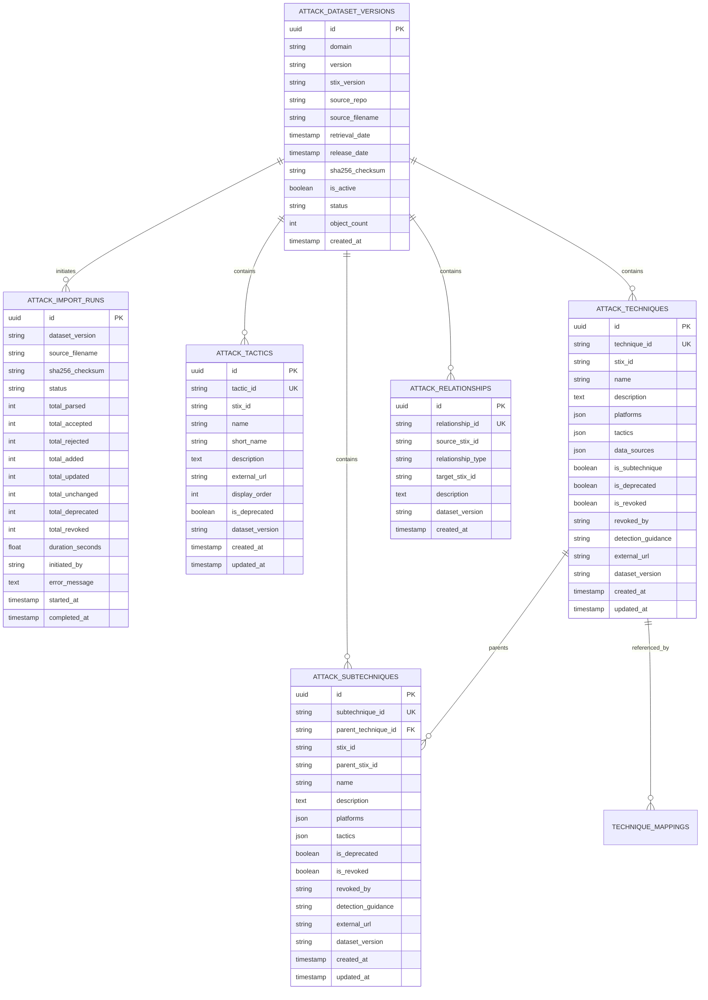

# SnareSight MITRE ATT&CK Relational Data Model

## 1. Entity Relationship Diagram

---

## 2. Table Specifications

### 2.1 `attack_dataset_versions`
Stores metadata and state transitions for each imported ATT&CK release.
- **`id`** (`UUID`, Primary Key): Internal unique identifier.
- **`domain`** (`VARCHAR(64)`): Domain identifier, default `enterprise-attack`.
- **`version`** (`VARCHAR(32)`): ATT&CK release string, e.g. `14.1`.
- **`stix_version`** (`VARCHAR(16)`): Standard specification version (`2.1`).
- **`sha256_checksum`** (`VARCHAR(64)`): Cryptographic hash verifying bundle integrity.
- **`is_active`** (`BOOLEAN`): Single active version flag per domain used for current detections.
- **`status`** (`VARCHAR(32)`): Lifecycle stage (`ACTIVE`, `SUPERSEDED`, `REJECTED`, `ARCHIVED`).
- **`object_count`** (`INTEGER`): Total tactics, techniques, subtechniques, and relationships imported.

### 2.2 `attack_tactics`
Matrix tactics representing adversary tactical goals.
- **`tactic_id`** (`VARCHAR(32)`, Unique): Official ATT&CK ID (e.g. `TA0001`, `TA0006`).
- **`stix_id`** (`VARCHAR(128)`): STIX object ID (`x-mitre-tactic--*`).
- **`name`** (`VARCHAR(128)`): Human-readable tactic name (`Initial Access`, `Credential Access`).
- **`short_name`** (`VARCHAR(64)`): STIX shortname used in `kill_chain_phases` (`initial-access`, `credential-access`).
- **`display_order`** (`INTEGER`): Canonical Enterprise matrix order (1 through 14).

### 2.3 `attack_techniques`
Primary ATT&CK techniques. Fully backward-compatible with Phase 3/P11 schema (`id`, `technique_id`, `name`, `tactics`, `description`).
- **`technique_id`** (`VARCHAR(32)`, Unique): Official identifier (e.g. `T1110`, `T1078`).
- **`stix_id`** (`VARCHAR(128)`): STIX object ID (`attack-pattern--*`).
- **`platforms`** (`JSONB/JSON`): Targeted operating systems and environments (`["Linux", "Windows", "macOS"]`).
- **`tactics`** (`JSONB/JSON`): Associated tactic short names (`["credential-access"]`).
- **`data_sources`** (`JSONB/JSON`): Telemetry data sources providing evidence.
- **`is_subtechnique`** (`BOOLEAN`): Flag indicating if object is a parent or sub-technique.
- **`is_deprecated`** / **`is_revoked`** (`BOOLEAN`): Lifecycle status within ATT&CK.

### 2.4 `attack_subtechniques`
Granular adversary actions representing concrete procedural variations of a technique.
- **`subtechnique_id`** (`VARCHAR(32)`, Unique): Subtechnique ID (e.g. `T1110.001`, `T1078.001`).
- **`parent_technique_id`** (`VARCHAR(32)`, Foreign Key -> `attack_techniques.technique_id`): Parent technique identifier.
- **`parent_stix_id`** (`VARCHAR(128)`): STIX ID of parent `attack-pattern`.

### 2.5 `attack_relationships`
STIX 2.1 relationships between ATT&CK entities (`subtechnique-of`, etc.).

### 2.6 `attack_import_runs`
Audit and operational log of every import, dry-run preview, and rollback operation.

