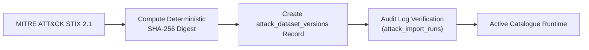

# SnareSight MITRE ATT&CK Cryptographic Data Provenance

## 1. Provenance Architecture

To comply with high-assurance security operations and threat intelligence integrity requirements, SnareSight implements end-to-end cryptographic provenance for all imported MITRE ATT&CK datasets.

---

## 2. Cryptographic Checksum Standards

- **Algorithm**: Standard SHA-256 (`hashlib.sha256`)
- **Digest Representation**: 64-character lowercase hexadecimal string
- **Integrity Validation**:
  - Before writing to PostgreSQL, the raw STIX payload is hashed.
  - The hash is compared against previous imports for identical releases (idempotency enforcement).
  - The hash is permanently stored in `attack_dataset_versions.sha256_checksum` and `attack_import_runs.sha256_checksum`.

---

## 3. Metadata & Provenance Records

Every dataset version tracks:
1. **Domain**: `enterprise-attack` (or future `mobile-attack`, `ics-attack`).
2. **Version**: Framework release string (e.g. `14.1`).
3. **STIX Version**: Data standard specification (`2.1`).
4. **Source Repository**: `https://github.com/mitre-attack/attack-stix-data`.
5. **Source Filename**: e.g., `enterprise-attack-v14.1.json`.
6. **Retrieval Timestamp**: UTC datetime of ingestion.
7. **Release Date**: Formal publication timestamp from STIX bundle metadata.
8. **SHA-256 Digest**: Exact cryptographic fingerprint of ingested bytes.
9. **Import Audit Record**: Linkage to `attack_import_runs` table with duration, operator identity, and counts.

