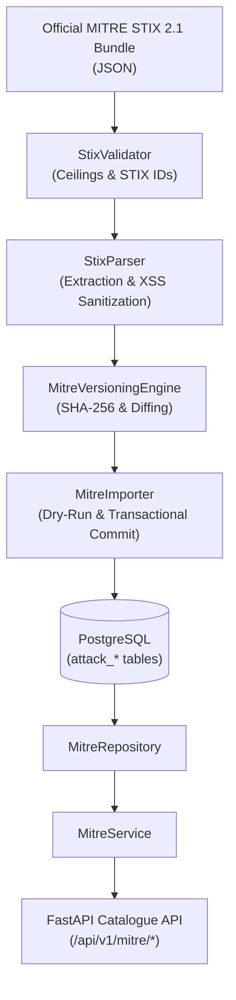

# SnareSight MITRE ATT&CK Integration Guide

## 1. Architectural Overview

SnareSight incorporates the official MITRE ATT&CK framework (Enterprise domain, STIX 2.1) to establish standardized cybersecurity semantics for adversary behaviors, tactics, techniques, and sub-techniques. 

In Phase 4 Task P19, the integration provides:
- **Versioned Intelligence Storage**: Isolated PostgreSQL storage for ATT&CK releases with cryptographically validated SHA-256 integrity digests.
- **Controlled Ingestion Pipeline**: STIX 2.1 JSON parser enforcing size limits, regex identity validation, HTML/script neutralization, and deterministic ID derivation.
- **Administrative Lifecycle Control**: Dry-run previews, approved transactional imports, and zero-downtime version rollbacks.
- **Read-Only Intelligence Catalogue APIs**: FastAPI query layer providing paginated technique listings, tactic grouping, and sub-technique hierarchical relations.

> [!IMPORTANT]
> **P19 Scope Boundary:**
> This module manages ATT&CK reference data. Automatic correlation or assignment of ATT&CK techniques to alerts/findings is strictly isolated to Phase 4 Task P20 (`P20 — Map Detection Rules to MITRE ATT&CK Techniques`).

---

## 2. Framework Domain and STIX 2.1 Data Source

- **Domain**: `enterprise-attack`
- **Data Standard**: STIX 2.1 JSON
- **Official Source**: `https://github.com/mitre-attack/attack-stix-data`
- **Default Baseline Version**: `v14.1`
- **Checksum Verification**: SHA-256 computed on canonical payload representation prior to insertion.

---

## 3. Core Components

### Component Breakdown:
1. **`StixValidator`**: Enforces bundle payload size limit (35 MB), object count ceilings (10,000 objects), strict STIX 2.1 ID patterns (`x-mitre-tactic--*`, `attack-pattern--*`, `relationship--*`), and sanitizes HTML/script elements from descriptions.
2. **`StixParser`**: Extracts tactics (`x-mitre-tactic`), techniques and sub-techniques (`attack-pattern`), and structural relationships (`relationship` with `subtechnique-of`). Derives external IDs (e.g. `T1110`, `T1110.001`) from `external_references`.
3. **`MitreVersioningEngine`**: Manages release metadata (`attack_dataset_versions`), computes SHA-256 hashes, generates preview diffs (added/updated/unchanged/revoked/deprecated), activates new versions, and rolls back to prior versions.
4. **`MitreImporter`**: Orchestrates transactional ingestion with full rollback on exception, ensuring the active catalogue is never corrupted during a failed run.
5. **`MitreRepository` & `MitreService`**: Provides structured domain operations, pagination, search, tactic filtering, and cached health checks.
6. **`routes.py`**: Exposes authenticated admin endpoints for import lifecycle and public/collector endpoints for read-only intelligence querying.

---

## 4. API Endpoints Reference

All endpoints are mounted under `/api/v1/mitre`.

| Method | Path | Auth Required | Description |
|---|---|---|---|
| `GET` | `/status` | No | Operational status, active version, total counts |
| `GET` | `/versions` | No | List of all imported dataset releases |
| `GET` | `/tactics` | No | All tactics in active version with order |
| `GET` | `/tactics/{tactic_id}` | No | Single tactic detail |
| `GET` | `/tactics/{tactic_id}/techniques` | No | Techniques categorized under specific tactic |
| `GET` | `/techniques` | No | Paginated techniques (filter by tactic, platform, search) |
| `GET` | `/techniques/{technique_id}` | No | Technique detail with nested sub-techniques |
| `GET` | `/techniques/{technique_id}/subtechniques` | No | Sub-techniques for parent technique |
| `GET` | `/subtechniques/{subtechnique_id}` | No | Single sub-technique detail |
| `POST` | `/import/dry-run` | Admin Bearer | Non-destructive preview diff of candidate bundle |
| `POST` | `/import/approve` | Admin Bearer | Transactional import and version activation |
| `POST` | `/import/rollback` | Admin Bearer | Revert active version to previous release |
| `GET` | `/imports` | Admin Bearer | Audit log of previous import runs |

---

## 5. Security & Safety Invariants

1. **Zero Dynamic Execution**: Neither `eval()`, `exec()`, nor shell subprocesses are invoked during bundle parsing.
2. **XSS Neutralization**: Injected `<script>` or event attributes inside external descriptions are stripped before persistence.
3. **Transactional Isolation**: All table modifications occur in a single ACID transaction. If an error occurs midway, SQLAlchemy session rolls back cleanly, leaving previous active records intact.
4. **Audit Trail**: Every import run, dry-run, and rollback is logged in `attack_import_runs` with user identity, runtime duration, object diffs, and error messages.

