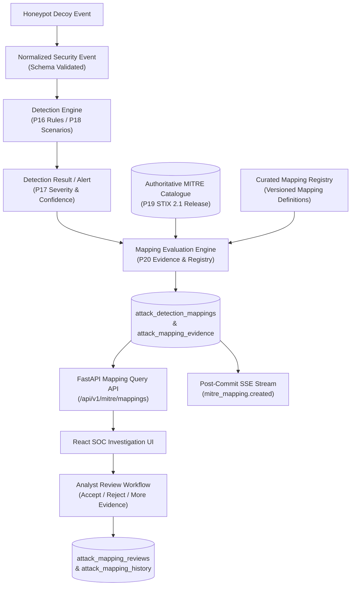

# SnareSight Evidence-Based MITRE ATT&CK Mapping Architecture

> [!WARNING]
> **CRITICAL OPERATIONAL NOTICE:**
> An ATT&CK mapping indicates that observed behavior is consistent with a documented adversary technique. It does not, by itself, establish attacker identity, successful compromise, intent, or completion of an attack.

---

## 1. Architectural Overview & Conceptual Pipeline

The SnareSight MITRE ATT&CK mapping system maps detected security events to MITRE ATT&CK Enterprise techniques based on observed, validated evidence.

---

## 2. Core Components

1. **Curated Mapping Registry (`MappingDefinitionRegistry`):**
   - Versioned repository of mapping definitions connecting SnareSight rule identifiers to official ATT&CK techniques.
   - Enforces required evidence fields, optional fields, exclusion criteria, default confidence, and category (`DIRECTLY_SUPPORTED`, `PARTIALLY_SUPPORTED`, `REQUIRES_ANALYST_REVIEW`, `NOT_MAPPED`).
2. **Mapping Confidence Engine (`MappingConfidenceEngine`):**
   - Calculates a separate mapping confidence score (0–100) and level (`LOW`, `MODERATE`, `HIGH`).
   - Evaluates behavior specificity, telemetry reliability, completeness of evidence, and absence of contradictory indicators.
3. **Mapping Evaluation Engine (`MappingEvaluator`):**
   - Invoked post-commit following alert generation.
   - Verifies evidence presence, validates target technique against active ATT&CK catalogue, executes confidence scoring, and creates persistent mapping and evidence records transactionally.
   - Fully idempotent: Re-evaluation of the same alert and mapping definition version returns existing records without row duplication.
4. **Analyst Review Workflow (`MappingService`):**
   - Authorized analysts can review proposed mappings (`ACCEPT`, `REJECT`, `REQUEST_MORE_EVIDENCE`).
   - Every review action is audited with timestamp, reviewer identity, rationale, and state transition history without overwriting original automated assessment data.
5. **Read-Only & Review APIs (`routes.py`):**
   - Exposes REST endpoints for querying mappings, viewing evidence details, filtering by technique, retrieving statistics, and submitting reviews.

---

## 3. Data Flow and Transaction Isolation

- **Asynchronous & Non-Blocking:** Mapping evaluation is triggered after the detection and alert transaction has successfully committed.
- **Resilience Guarantee:** If the ATT&CK catalogue is empty or an error occurs during mapping evaluation, the detection finding and alert remain preserved in PostgreSQL.
- **Streaming Invariant:** Server-Sent Events (`mitre_mapping.created`, `mitre_mapping.updated`, `mitre_mapping.reviewed`) are published strictly post-commit.

