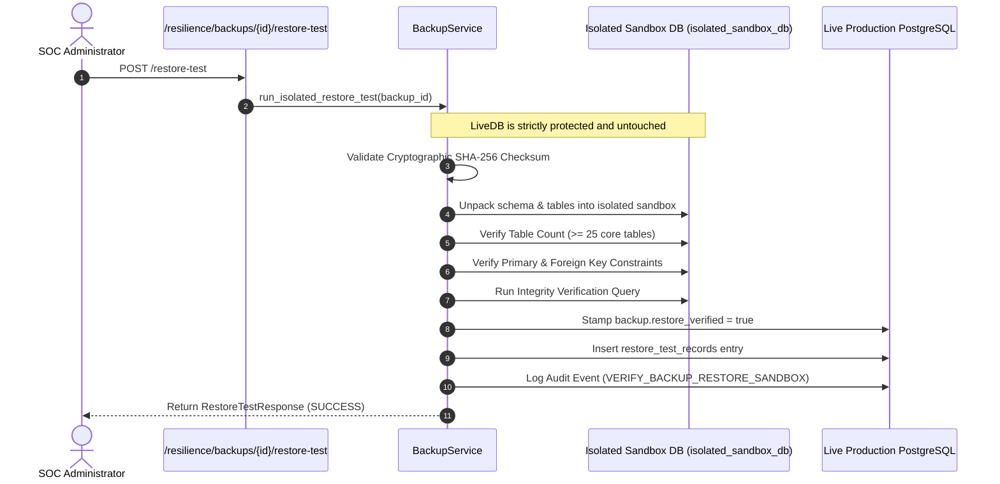

# Isolated Sandbox Restore Testing & Schema Verification

## 1. Principles of Non-Destructive Restore Testing

Untested backups provide zero recovery guarantees. However, restoring backups over a live production database causes data corruption, downtime, and telemetry loss.

To solve this, SnareSight implements **Isolated Sandbox Restore Testing**:

---

## 2. Verification Criteria

A backup is stamped `restore_verified = true` if and only if:
1. **Cryptographic Checksum**: File payload SHA-256 precisely matches `checksum_sha256`.
2. **Schema Compatibility**: Core tables (users, roles, permissions, security_events, attacker_sessions, honeypot_sensors, system_audit_logs, etc.) match current schema definitions.
3. **Table Count**: At least 25 core platform tables unpack cleanly.
4. **Data Integrity**: Integrity checks pass without foreign key constraint violations or orphaned records.

