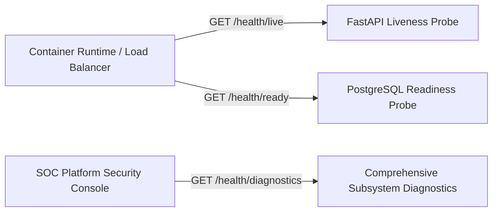

# Diagnostic Probes, Subsystem Health & Readiness Telemetry

## 1. Probing Strategy

SnareSight exposes layered health endpoints tailored for container orchestration (Kubernetes / Docker Compose), automated load balancers, and administrative operators:



---

## 2. Probe Specifications

### 2.1 Liveness Probe (`GET /api/v1/resilience/health/live`)
- **Intent**: Verifies FastAPI process responsiveness.
- **Latency**: $< 2\text{ms}$.
- **Authentication**: Unauthenticated (open to internal container network).
- **Response**:
  ```json
  {
    "status": "UP",
    "timestamp": "2026-10-31T22:45:00.000Z",
    "service": "SnareSight SOC Platform"
  }
  ```

### 2.2 Readiness Probe (`GET /api/v1/resilience/health/ready`)
- **Intent**: Validates that database connection pool can execute transactions.
- **Query**: Executes `SELECT 1`.
- **Latency**: Measured and returned in `latency_ms`.
- **Response**:
  ```json
  {
    "status": "READY",
    "database": "CONNECTED",
    "latency_ms": 1.45,
    "timestamp": "2026-10-31T22:45:00.000Z"
  }
  ```

### 2.3 Detailed Diagnostics (`GET /api/v1/resilience/health/diagnostics`)
- **Intent**: Deep inspection across all 7 platform components.
- **Permissions**: Requires `view_dashboard`.
- **Components Checked**:
  1. `FastAPI Core Engine`: Uptime, thread count, framework version.
  2. `Database Subsystem`: Pool status, active query latency.
  3. `Telemetry Ingestion Pipeline`: Queue depth, rate-limiting status.
  4. `Detection & Correlation Engine`: Loaded detection rules count (18+), workers.
  5. `Honeypot Sensor Fleet`: Active fleet count, availability percentage.
  6. `SSE Live Telemetry Broker`: Active subscribers, heartbeat interval.
  7. `Audit Log & Compliance Subsystem`: Chain integrity status, immutability check.
- **Historical Snapshots**: Each check commits a time-series entry to `component_health_records`.

