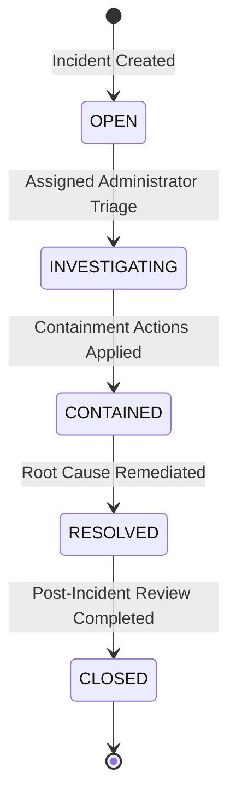

# Internal Security Incident Management & Containment Workflows

## 1. Purpose & Separation

Internal platform security incidents represent potential compromises, failures, or operational disruptions within the SnareSight control plane itself. They are tracked separately from external honeynet attacker investigations.

---

## 2. Incident Lifecycle States

1. **`OPEN`**: Incident registered by rule engine or administrative operator.
2. **`INVESTIGATING`**: Lead administrator analyzes affected components and linked internal alerts.
3. **`CONTAINED`**: Containment notes recorded (e.g. JWT tokens revoked, administrative firewall rule updated, sensor credentials rotated).
4. **`RESOLVED`**: Recovery actions validated; resolution summary documented.
5. **`CLOSED`**: Post-mortem complete and audit trail closed.

---

## 3. Incident Notes Stream

Collaborating administrators append timestamped entries to `internal_incident_notes`:
- **`OBSERVATION`**: Factual discovery or telemetry finding.
- **`CONTAINMENT`**: Action taken to mitigate damage or isolate compromised accounts.
- **`RECOVERY`**: Action taken to restore healthy operational state.
- **`ROOT_CAUSE`**: Analysis of the vulnerability or underlying system defect.

