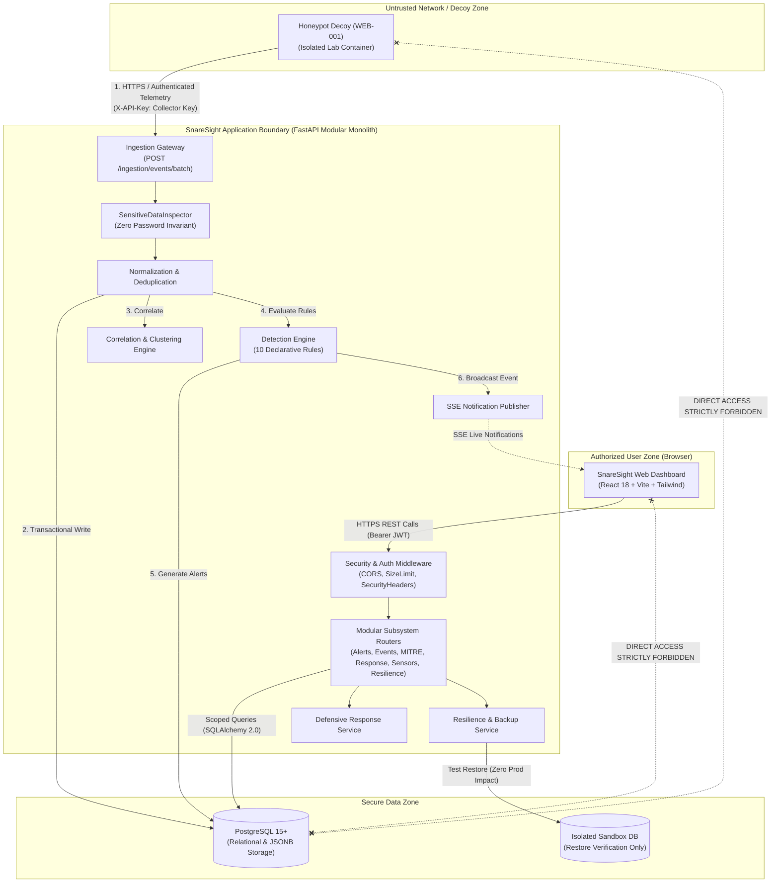

# SnareSight Release Candidate System Architecture

**Document ID:** ARC-P37-001  
**Project:** SnareSight — Deception-Driven Threat Detection Platform  
**Release Target:** v1.0.0-rc1  
**Date:** October 31, 2026  
**Status:** APPROVED ARCHITECTURAL SPECIFICATION  

---

## 1. System Architecture Overview

SnareSight is architectured as a modular monolith designed for sub-millisecond telemetry ingestion, deterministic threat detection, cross-session correlation, and analyst-guided incident response. The platform runs entirely as a browser-based web application.

---

## 2. Defensive Boundaries & Trust Architecture

### 2.1 Network & Trust Boundaries
1. **Decoy Isolation Boundary:** Honeypot decoys reside in an isolated network segment (or test container). Honeypots **never possess direct database connection credentials**. All telemetry is pushed outbound to the ingestion endpoint via authenticated HTTPS batches with pre-shared API keys (`X-API-Key`).
2. **Browser Client Boundary:** The React web frontend communicates strictly via the REST API and Server-Sent Events gateway. No database ports (e.g., PostgreSQL port 5432) are ever exposed to the client browser.
3. **Internal Application Boundary:** Telemetry ingestion routes are strictly separated from administrative and analyst operational routes. Ingestion requires collector source authentication; analyst workflows require JWT bearer authentication with RBAC role authorization.

### 2.2 Data Invariants & Privacy Controls
1. **Zero Password Persistence Invariant:** No plaintext password, password hash, API secret, or private key material is ever accepted or stored. Incoming telemetry is audited recursively by `SensitiveDataInspector`. Any record containing unauthorized credential keys is rejected with `PROHIBITED_SENSITIVE_DATA`. Honeypots record only boolean flags (`password_present: True`) and one-way irreversible SHA-256 username fingerprints.
2. **Deterministic Lab Telemetry:** All demonstration and synthetic attack scenarios operate exclusively within RFC 5737 test subnets (`198.51.100.0/24`, `203.0.113.0/24`, `192.0.2.0/24`).
3. **Forensic Evidence Preservation:** The platform incorporates legal evidence preservation holds (`EvidencePreservationHoldModel`). When an evidence hold is active on an event, session, or alert, standard retention pruning and demonstration cleanup routines are strictly blocked from deleting the protected records.

---

## 3. Subsystem Interconnection Matrix

| Subsystem | Upstream Producers | Downstream Consumers | Protocol & Boundary Contract |
| :--- | :--- | :--- | :--- |
| **Ingestion Pipeline** | Honeypot Sensors, Demonstration Lab | Normalizer, Database, SSE Stream | REST (`POST /api/v1/ingestion/events/batch`), JSON, `X-API-Key` |
| **Detection Engine** | Event Normalizer | Threat Assessment, Alert Service | In-process Python service call, immutable normalized event dictionary |
| **Correlation Engine** | Event Normalizer | Session Explorer, Campaign Intelligence | In-process Python service call, relational foreign keys |
| **SOC Dashboard API** | Database, Analytics Engine | React Web Browser | REST (`GET /api/v1/*`), Bearer JWT Authorization |
| **Live Notifications** | Ingestion & Detection Engines | React SSE Hook | Server-Sent Events (`GET /api/v1/stream/events`), `text/event-stream` |
| **Resilience & Recovery** | Scheduled Tasks, Admin Users | PostgreSQL, Sandbox SQLite | Managed Backup Engine, SHA-256 verification |

