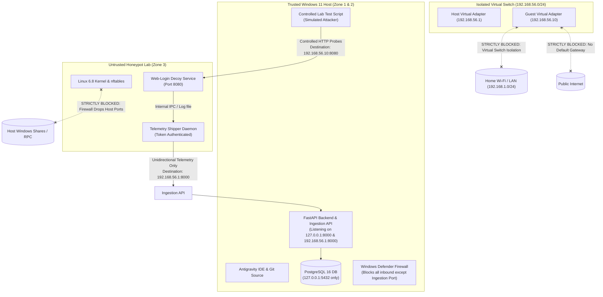

# SnareSight: Virtual Network Design Specification
**Document ID:** SEC-NET-001  
**Phase:** 2 — Lab Isolation and Honeypot  
**Status:** Approved Design Baseline  

---

## 1. Virtual Networking Modes Evaluation

To determine the safest isolation topology, the four standard virtual networking modes were evaluated:

| Virtual Network Mode | Host $\to$ Guest Access | Guest $\to$ Host Access | Guest $\to$ Local LAN | Guest $\to$ Internet | Isolation Assessment for Honeypot |
| :--- | :--- | :--- | :--- | :--- | :--- |
| **Bridged Networking** | Direct | Direct | Full Direct Access | Direct (via Router) | **STRICTLY PROHIBITED:** Exposes your home router and family devices to honeypot probes. |
| **NAT (Standard)** | Port-Forward Only | Host Outbound Access | Routed | Full Outbound Access | **DANGEROUS:** Allows a compromised decoy to probe external Internet targets or internal LAN. |
| **Internal VM Network** | None (unless VM on it) | None | Zero | Zero | **Maximum Isolation:** Ideal for multi-VM labs, but requires a routing VM for telemetry intake. |
| **Host-Only Network** | Private Virtual NIC | Restricted to Host Virtual IP | Zero | Zero | **RECOMMENDED PRIMARY:** Zero external routing, zero LAN access, strict point-to-point telemetry. |

---

## 2. Network Topology Comparison & Selection

### Option A: Simple Isolated Development Lab (Recommended Primary)
* **Architecture:** A single Linux Honeypot VM attached exclusively to a **Host-Only Virtual Adapter** (`vboxnet0` or `VMnet1`).
* **Addressing Concept:**
  * Virtual Switch Subnet: `192.168.56.0/24` (Private non-routable link).
  * Windows Host Virtual Adapter: `192.168.56.1` (Telemetry receiver & API listener).
  * Honeypot Guest VM: `192.168.56.10` (Web decoy on port `8080`).
  * Controlled Test Client: A test harness script running locally on the Windows host binding explicitly to `192.168.56.1`.
* **Telemetry Path:** Unidirectional HTTP/TLS telemetry shipped from `192.168.56.10` $\to$ `192.168.56.1:8000/api/v1/ingest/events`.
* **Egress Policy:** Zero default gateway is assigned to the VM. Outbound packets destined for anything outside `192.168.56.0/24` are discarded by the virtual switch.
* **Why Selected:** Cleanest, simplest, and most beginner-friendly design that delivers 100% isolation from the physical home network.

### Option B: Stronger Dual-Subnet Segmented Lab (Advanced Alternative)
* **Architecture:** Uses two virtual switches:
  1. `vSwitch-Decoy` (Internal Network: `10.10.10.0/24`): Connects Decoy VM and a separate Kali/Ubuntu Test Client VM.
  2. `vSwitch-Telemetry` (Host-Only Network: `192.168.56.0/24`): Second virtual NIC on the Decoy VM connecting strictly to the Windows Host Ingestion port.
* **Evaluation:** Provides strict physical separation between attacker traffic and telemetry traffic. However, running two virtual machines requires an additional 2 GB of RAM and increases configuration complexity. Reserved as a future scaling option.

---

## 3. Network Trust-Boundary Topology (Mermaid)

