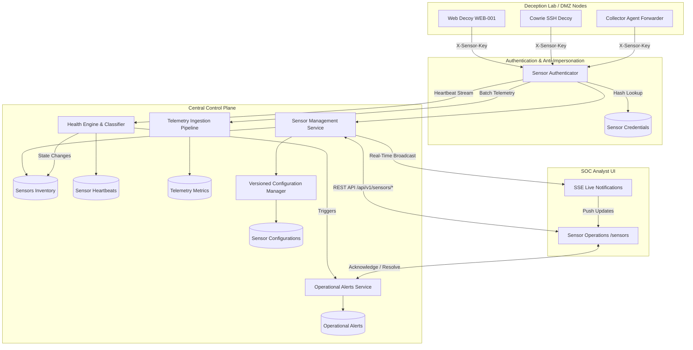

# Honeypot Sensor Management & Health Monitoring Architecture

## 1. Overview & System Purpose

The **SnareSight Sensor Operations Subsystem** provides a centralized, secure, and resilient control plane for managing deceptive telemetry sensors, monitoring node availability, maintaining versioned sensor configurations, and tracking telemetry ingestion health.

In strict compliance with SnareSight architectural constraints:
- **Operational Health vs. Threat Activity:** Sensor offline status or ingestion delays are classified strictly as **operational reliability issues**, never as threat alerts or security incidents.
- **Strict Decoupling:** Honeypot decoys run in isolated lab/DMZ networks with zero direct database drivers or credentials to PostgreSQL. Telemetry and heartbeats flow exclusively through authenticated HTTP gateways.
- **Anti-Impersonation:** Each sensor possesses a distinct, cryptographically random API key. Telemetry submissions verify that the authenticated key owner matches the reported sensor identifier.
- **Fail-Safe Observability:** Sensors report heartbeat vitals (CPU, memory, buffered events, latency) allowing the health engine to detect degraded or disconnected sensors with tolerance for network jitter.

---

## 2. Component Architecture Diagram

---

## 3. Database Schema Overview

The Sensor Operations schema is implemented in `backend/app/db/models/sensor.py` across 7 relational tables:

1. **`sensors`**: Central sensor inventory record tracking `sensor_id`, `name`, `sensor_type`, `sensor_version`, `deployment_environment`, `lab_zone`, `operational_status`, `health_status`, `heartbeat_interval_seconds`, `missed_heartbeat_count`, `last_heartbeat_at`, `last_telemetry_at`, `current_config_version`, `supported_telemetry_types`, and administrative notes.
2. **`sensor_credentials`**: Cryptographically hashed API credentials with key metadata (`key_id`, `key_prefix`, `hashed_api_key`, `status`: ACTIVE/REVOKED/EXPIRED, `expires_at`, `revoked_at`, `revocation_reason`, `last_used_at`).
3. **`sensor_heartbeats`**: Time-series heartbeat log capturing `sensor_id`, `timestamp`, `status`, `latency_ms`, `metrics_payload` (CPU %, RAM MB, buffered events), and `error_category`.
4. **`sensor_configurations`**: Versioned declarative configuration records tracking `version`, `config_payload`, `is_current`, `change_reason`, and `updated_by`.
5. **`operational_alerts`**: Segregated operational alerts tracking `alert_id`, `sensor_id`, `alert_category` (`SENSOR_HEARTBEAT_OVERDUE`, `SENSOR_OFFLINE`, `TELEMETRY_INGESTION_FAILURE`), `severity`, `status` (`OPEN`, `ACKNOWLEDGED`, `RESOLVED`), timestamps, `evidence_payload`, and resolution notes.
6. **`sensor_maintenance_history`**: Audit trail of planned maintenance periods tracking start/end times and reasons.
7. **`sensor_telemetry_metrics`**: Windowed delivery metrics tracking events received, validated, rejected, persisted, and duplicates per sensor.

---

## 4. Operational Boundaries

- **No Remote Shell Commands:** SnareSight does not execute arbitrary remote commands on honeypot nodes.
- **No Dynamic Firewall Changes:** The platform does not manipulate iptables, external network routes, or cloud security groups.
- **Segregated Operations:** Operational alerts are stored in `operational_alerts` and never mixed with security threat detections (`alerts`).

