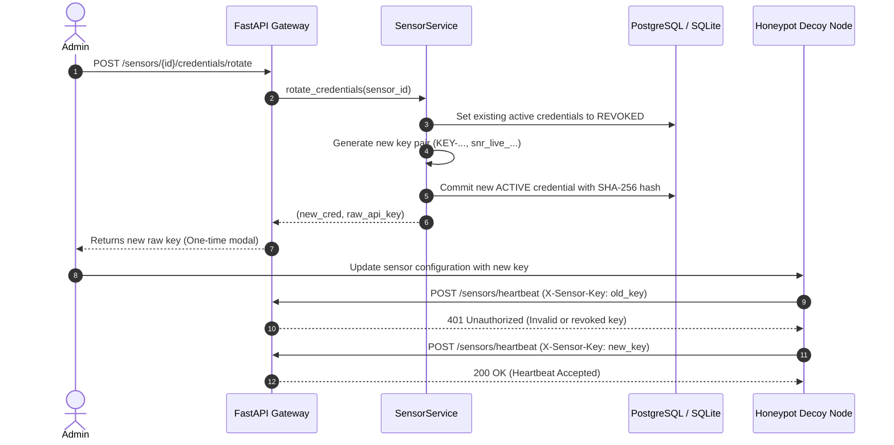

# Sensor Authentication & Cryptographic Credentials

## 1. Authentication Mechanism

SnareSight replaces shared static keys with **per-sensor cryptographic API credentials**.

### Key Generation & Format
- Key prefix: `snr_live_`
- Entropy: 32 bytes of cryptographically secure random bytes via `secrets.token_urlsafe(32)`
- Full raw key example: `snr_live_aBcDeF1234567890_-xyz...`
- Key ID: `KEY-` + 12 hex characters (e.g. `KEY-A1B2C3D4E5F6`)
- Safe masked prefix: `snr_live_aBcDeF...` (the first 12 characters, stored for identification and administrative display)

---

## 2. Storage & Hashing Policy

Raw sensor API keys are **never stored** in the database:
$$\text{hashed\_api\_key} = \text{SHA256}(\text{raw\_api\_key})$$

1. **One-Time Display:** The raw API key is returned exactly once in the response body during sensor registration or credential rotation.
2. **Database Integrity:** Only `hashed_api_key`, `key_prefix`, `key_id`, and status (`ACTIVE`, `REVOKED`, `EXPIRED`) are persisted to `sensor_credentials`.
3. **Redaction Guarantee:** No API endpoint (GET `/sensors`, GET `/sensors/{id}`, or `/summary`) returns the raw API secret.

---

## 3. Credential Lifecycle: Rotation & Revocation



---

## 4. Header & Ingestion Protocol

Sensors authenticate requests by including the HTTP header:
```http
X-Sensor-Key: snr_live_...
```
The FastAPI dependency `authenticate_sensor_request`:
1. Hashes the header value via SHA-256.
2. Looks up an active record in `sensor_credentials`.
3. Verifies that the credential is not expired.
4. Verifies that the associated sensor is not `DISABLED` or `RETIRED`.
5. Updates `credential.last_used_at` with UTC timestamp.

