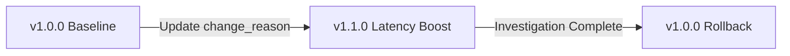

# Controlled Sensor Configuration Management

## 1. Overview & Operational Governance

Centralized sensor configuration in SnareSight manages approved behavioral settings without exposing dangerous shell execution or network configuration controls.

Approved configuration settings:
- `heartbeat_interval_seconds`: Expected heartbeat cadence (10–3600 seconds).
- `log_level`: Verbosity (`INFO`, `DEBUG`, `WARNING`, `ERROR`).
- `deception_latency_ms`: Artificial response delay introduced on deceptive routes (0–3000ms).
- `canary_tokens_enabled`: Boolean flag toggling synthetic decoy credentials in login forms.
- `max_batch_size`: Maximum events submitted per ingestion batch (default 250).

---

## 2. Versioned Configuration Architecture

Every configuration mutation creates an immutable record in `sensor_configurations`:
- `version`: Semantic version string (e.g. `1.0.0`, `1.1.0`).
- `config_payload`: Strongly-typed JSON object containing approved keys only.
- `is_current`: Boolean flag designating the active desired configuration.
- `change_reason`: Mandatory plain-text justification.
- `updated_by`: Authenticated administrator username.

---

## 3. Rollback Mechanism

If a newly committed configuration induces instability, excessive resource usage, or telemetry failure, administrators can perform a one-click rollback:
1. Administrator selects previous version (e.g., `1.0.0`) from configuration history.
2. The system deactivates the current version (`is_current = False`).
3. Re-activates `target_version` as `is_current = True`.
4. Logs an immutable audit event: `SENSOR_CONFIG_ROLLED_BACK`.
5. Emits SSE event `sensor_config_updated`.

---

## 4. Safety Constraints & Prohibitions

- **No Remote Shell Commands:** Configuration payloads cannot execute bash scripts, powershell commands, or binary updates.
- **No Firewall Modification:** The configuration engine cannot open external network ports or alter routing tables.
- **No Isolation Weakening:** Settings cannot bypass credential omission assertions or disable HMAC username hashing.

