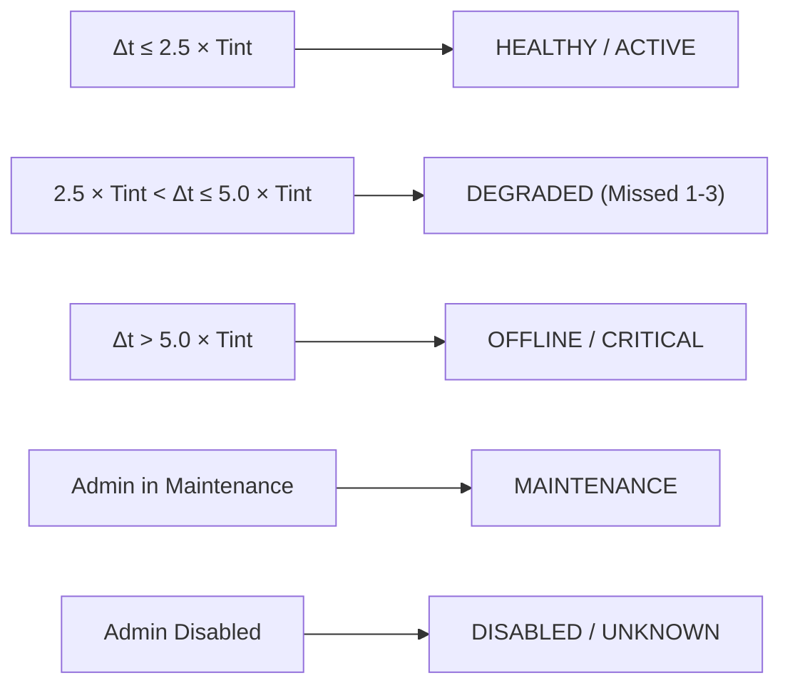

# Sensor Heartbeat & Health Monitoring Engine

## 1. Health Monitoring Design Principles

Honeypot sensors run in diverse, sometimes hostile, network segments (DMZs, external cloud sandboxes, guest VMs). Health monitoring in SnareSight accounts for transient network jitter, packet reordering, and restart cycles.

Key operational rules:
1. **Never mark offline on a single missed heartbeat:** Short delays or brief buffer flushes must not trigger critical alerts.
2. **Jitter-Tolerant Windowing:** Up to $2.5\times$ the configured heartbeat interval is considered normal operating latency.
3. **UTC Timestamps:** All heartbeats, state transitions, and evaluation records strictly use UTC.
4. **Factual Separation:** Sensor process connectivity is distinct from pipeline ingestion health and database health.

---

## 2. Health Classification Thresholds

Let $T_{\text{int}}$ be `heartbeat_interval_seconds` (e.g. 60 seconds), and $\Delta t = t_{\text{now}} - t_{\text{last\_heartbeat}}$.



| State | Condition | Health Classification | Operational Action |
| :--- | :--- | :--- | :--- |
| **`HEALTHY`** | $\Delta t \le 2.5 \times T_{\text{int}}$ | `HEALTHY` | Normal processing. Automatically resolves overdue alerts. |
| **`DEGRADED`** | $2.5 \times T_{\text{int}} < \Delta t \le 5.0 \times T_{\text{int}}$ | `DEGRADED` | Generates `SENSOR_HEARTBEAT_OVERDUE` operational alert. |
| **`OFFLINE`** | $\Delta t > 5.0 \times T_{\text{int}}$ | `CRITICAL` | Generates `SENSOR_OFFLINE` operational alert. Flags telemetry ingestion. |
| **`MAINTENANCE`** | Admin-set flag | `HEALTHY` | Suppresses availability alerts during patching. |
| **`DISABLED`** | Admin-set flag | `UNKNOWN` | Gateway blocks telemetry with `403 Forbidden`. |

---

## 3. Heartbeat Payload Vitals

Every periodic heartbeat reports node vitals:
```json
{
  "sensor_id": "SENSOR-WEB-001",
  "status": "HEALTHY",
  "latency_ms": 12.4,
  "metrics_payload": {
    "cpu_percent": 14.2,
    "memory_mb": 192.5,
    "events_buffered": 0,
    "queue_depth": 0
  },
  "error_category": null
}
```

These metrics allow SOC administrators to distinguish:
- **Host Resource Exhaustion:** CPU > 95% or RAM spikes indicate VM sizing issues.
- **Buffer Backlog:** `events_buffered > 0` indicates ingestion queue congestion.
- **Process Failure:** Heartbeat loss with low CPU indicates crash or network interruption.

