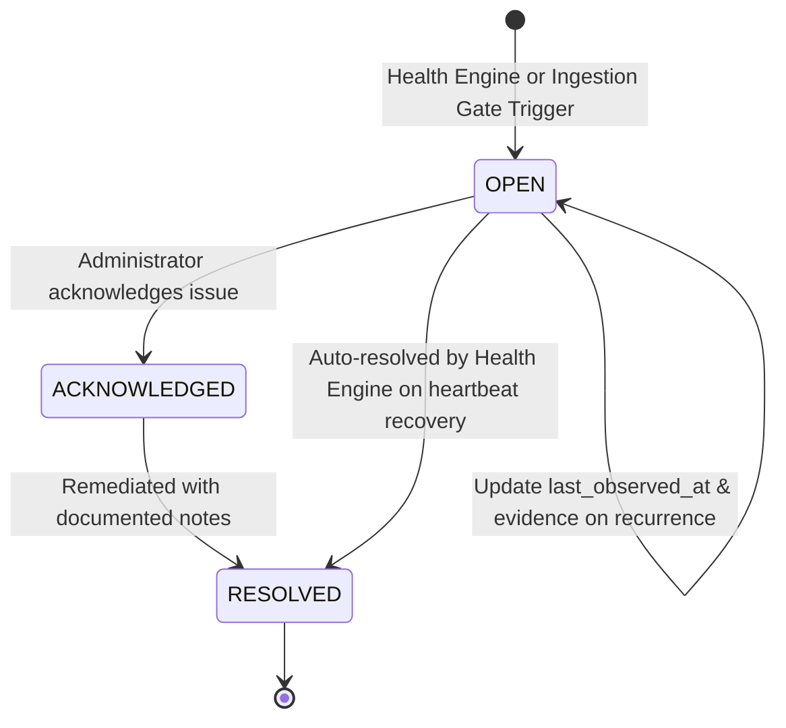

# Segregated Operational Alerts Subsystem

## 1. Operational Alerts vs. Threat Detections

A fundamental design invariant in SnareSight is the **strict segregation** between operational health anomalies and security threat alerts:

| Aspect | Operational Alert (`operational_alerts`) | Security Threat Alert (`alerts`) |
| :--- | :--- | :--- |
| **Origin** | Heartbeat loss, forwarding delays, schema validation errors, token revocation. | Adversary credential stuffing, directory scanning, brute force, exploit probing. |
| **Trigger** | Sensor node or network connectivity failure. | Telemetry event matching a detection rule. |
| **Impact on Threat Score** | **Zero.** Offline sensors do NOT increase campaign severity or actor threat score. | Elevates threat score and updates attacker profile. |
| **Handling Persona** | Deception Platform Administrator / DevOps. | SOC Analyst / Incident Responder. |
| **Database Table** | `operational_alerts` | `alerts` / `alert_evidence` |

---

## 2. Operational Alert Categories

| Category | Description | Default Severity | Auto-Resolved? |
| :--- | :--- | :--- | :--- |
| **`SENSOR_HEARTBEAT_OVERDUE`** | Missed 1 to 3 expected heartbeats ($2.5\times - 5.0\times$ interval). | `MEDIUM` | Yes, on resumed heartbeat. |
| **`SENSOR_OFFLINE`** | Persistent communication loss (> $5.0\times$ interval). | `HIGH` / `CRITICAL` | Yes, on reconnected heartbeat. |
| **`SENSOR_REGISTRATION_NO_HEARTBEAT`**| Sensor registered but no initial heartbeat received within 3 intervals. | `LOW` | Yes, on initial heartbeat. |
| **`TELEMETRY_INGESTION_FAILURE`** | Batch rejected due to schema error, sanitization failure, or malformed JSON. | `HIGH` | Manual resolution. |
| **`AUTH_FAILURE`** | Sensor attempted connection with expired or revoked API credentials. | `MEDIUM` | Manual resolution. |
| **`CONFIG_MISMATCH`** | Sensor node reports running configuration version differing from current. | `LOW` | Auto on config sync. |

---

## 3. Operational Alert Lifecycle

- **Deduplication:** Repeated occurrences of an anomaly for the same sensor update `last_observed_at` and `evidence_payload` instead of spawning duplicate alert rows.
- **Auditing:** Every acknowledgement and manual resolution logs an immutable event in `system_audit_logs`.

