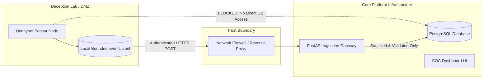

# Security Boundaries & Lab Isolation Model

## 1. Network & Database Decoupling

Honeypots operate in untrusted environments where adversaries may attempt container escapes, denial of service, or lateral movement. SnareSight enforces a strict **zero-trust boundary** between honeypot nodes and central platform databases:

1. **No PostgreSQL Drivers in Sensors:** Honeypot nodes have neither PostgreSQL drivers (`psycopg`, `asyncpg`) nor database connection strings.
2. **Untrusted Input Policy:** All events received from sensors are treated as hostile input. Field lengths, types, and characters are strictly validated by Pydantic schemas.
3. **Loopback/Isolated Binding:** Honeypot nodes bind to isolated virtual lab interfaces or DMZ IPs, never sharing kernel network namespaces with the PostgreSQL host.

---

## 2. API Authorization & RBAC Matrix

All administrative operations on sensors enforce RBAC via JSON Web Tokens (JWT):

| API Capability | Permission Required | Allowed Roles |
| :--- | :--- | :--- |
| **View Sensor Inventory & Details** | `Permission.VIEW_DASHBOARD` | `VIEWER`, `ANALYST`, `ADMIN` |
| **Register Sensor** | `Permission.MANAGE_SENSORS` | `ANALYST`, `ADMIN` |
| **Rotate / Revoke Credentials** | `Permission.MANAGE_SENSORS` | `ANALYST`, `ADMIN` |
| **Update Sensor Operational Status** | `Permission.MANAGE_SENSORS` | `ADMIN` |
| **Toggle Maintenance Mode** | `Permission.MANAGE_SENSORS` | `ANALYST`, `ADMIN` |
| **Commit / Rollback Configuration** | `Permission.MODIFY_SYSTEM_CONFIGURATION` | `ADMIN` |
| **Acknowledge / Resolve Operational Alerts** | `Permission.ACKNOWLEDGE_ALERTS`, `RESOLVE_ALERTS` | `ANALYST`, `ADMIN` |
| **Submit Heartbeat** | Verified `X-Sensor-Key` header | Sensor Node Only |

---

## 3. Strict Defensive Invariants

- **No Offensive Exploits:** SnareSight contains zero offensive hacking tools or retaliatory payload dispatchers.
- **No Automated External IP Blocking:** The platform operates strictly as an internal detection and deception system.
- **Sensitive Data Redaction:** Passwords are never persisted, and usernames are hashed via keyed HMAC-SHA256 at the sensor level.

