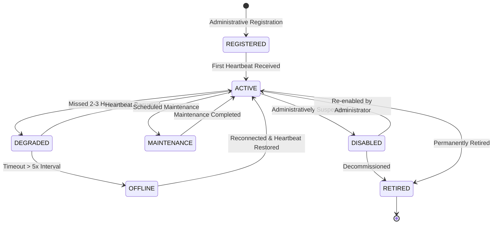

# Sensor Registration & Lifecycle State Machine

## 1. Overview & Registration Workflow

Every deception node, honeypot container, or telemetry forwarder in SnareSight must undergo explicit administrative registration before transmitting heartbeats or telemetry batches.

Registration enforces:
- Unique, immutable `sensor_id` assignment (e.g. `SENSOR-WEB-001`, `SENSOR-COWRIE-01`).
- Archetype specification (`WEB_LOGIN_DECOY`, `COWRIE_SSH`, `GENERIC_COLLECTOR`).
- Baseline configuration generation (v1.0.0).
- Immediate cryptographic API key generation with safe masked prefix (`snr_live_xxxx...`).

---

## 2. Sensor Lifecycle State Machine

---

## 3. Lifecycle States & Operational Semantics

| State | Definition | Ingestion Behavior | Heartbeat Expected |
| :--- | :--- | :--- | :--- |
| **`REGISTERED`** | Newly created record; awaiting first heartbeat from sensor node. | Rejects telemetry until active | Yes (within 3x interval) |
| **`ACTIVE`** | Sensor is healthy, transmitting periodic heartbeats and valid telemetry. | Processes normally | Yes |
| **`DEGRADED`** | Missed 1 to 3 expected heartbeats. Heartbeat alert generated. | Processes with alert flag | Yes |
| **`OFFLINE`** | Persistent communication timeout (> 5x interval). Critical operational alert. | Rejects or flags delayed events | Yes |
| **`MAINTENANCE`** | Planned administrative downtime (patching, reconfiguration). Alerts suppressed. | Ingestion suspended | No |
| **`DISABLED`** | Administratively suspended due to misconfiguration or suspected breach. | `403 Forbidden` on all requests | No |
| **`RETIRED`** | Permanently decommissioned sensor. Historical metrics preserved. | `403 Forbidden` permanently | No |

---

## 4. Anti-Impersonation Protection

When a sensor registers, its unique `sensor_id` is bonded to the generated API key.
Upon every heartbeat or telemetry batch submission:
$$\text{Sensor ID from Authentication Header} == \text{Sensor ID in Payload}$$
If a sensor node with key `SENSOR-COWRIE-01` submits an event or heartbeat with `sensor_id: "SENSOR-WEB-001"`, the gateway immediately rejects the request with `403 Forbidden` (`Sensor impersonation prohibited`) and logs an audit security event.

