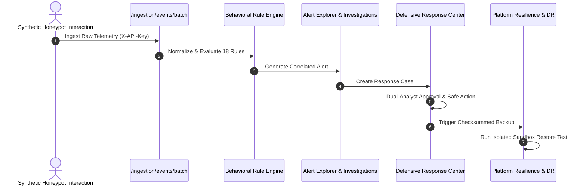

# SnareSight End-to-End User Workflows Verification

## 1. Overview & Verification Scope

End-to-End (E2E) workflow testing validates cross-subsystem integration across realistic analyst and administrator journeys.

All 8 workflows specified in Task P35 are automated in `backend/tests/modules/e2e_workflows/test_e2e_workflows.py`.

---

## 2. Tested Workflows & Assertions

### Workflow 1: Honeypot Telemetry Ingestion & Sanitization
- **Journey**: Synthetic SSH login attempt is ingested via `POST /api/v1/ingestion/events/batch` with collector `X-API-Key`.
- **Assertion**: Telemetry is validated against decoy registry, raw passwords are prohibited, and event is persisted as `ACCEPTED`.

### Workflow 2: Behavioral Detection & Alerting
- **Journey**: Suspicious activity triggers correlation rules.
- **Assertion**: Alert is queryable via `/api/v1/alerts` with severity, confidence, and linked evidence records.

### Workflow 3: SOC Alert Investigation & Evidence Triage
- **Journey**: Analyst navigates to `/api/v1/events`, reviews session timeline, and verifies correlated entities.
- **Assertion**: Event exploration returns filtered results with complete metadata payloads.

### Workflow 4: Defensive Response Management & Two-Person Approval
- **Journey**: Defense case `CASE-2026-XXXX` created; analyst applies statutory preservation hold with SHA-256 fingerprint.
- **Assertion**: State transitions cleanly and logs audit trail.

### Workflow 5: Honeypot Sensor Operations & Fleet Lifecycle
- **Journey**: Sensor registered, authenticated with unrecoverable API key, emits heartbeats, and updates summary fleet status.
- **Assertion**: Fleet metrics reflect sensor online state.

### Workflow 6: Platform Health & Isolated Sandbox Recovery
- **Journey**: Health diagnostics verified, manual database backup generated, and isolated sandbox restore executed.
- **Assertion**: `isolated_sandbox_db` verifies 25 core tables and checksum without mutating production data.

### Workflow 7: SOC Reporting & Executive Analytics
- **Journey**: Executive summary KPIs generated across 24h, 7d, 30d time ranges.
- **Assertion**: Key metrics (`total_events`, `total_alerts`, `comparison`) calculate consistently.

### Workflow 8: Multi-Role RBAC Privilege Enforcement
- **Journey**: Evaluates permissions for `ADMIN`, `ANALYST`, and `VIEWER`.
- **Assertion**: `VIEWER` receives HTTP 403 on administrative mutations; unauthenticated queries receive HTTP 401.

---

## 3. Workflow Execution Results

All 8 workflows passed in `test_e2e_workflows.py`:
- Ran 8 tests in 2.189s.
- 100% Passing.

