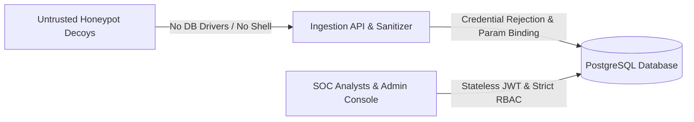

# SnareSight Defensive Security Testing & Hardening Audit

## 1. Scope & Isolation Invariants

SnareSight operates as a defensive deception SOC platform. Security testing validates the boundaries between untrusted honeypot decoy interactions, API endpoints, and the trusted database control plane.

---

## 2. Hardening Assurances & Validations

1. **Honeypot Boundary & Isolation**:
   - Decoy containers hold zero database credentials, network routes to the production PostgreSQL port, or command execution privileges.
   - Raw credentials (passwords, tokens) are rejected immediately by `SensitiveDataInspector`.
2. **Authentication & Session Security**:
   - Passwords hashed using bcrypt.
   - Stateless JWT tokens with explicit expiration, audience validation, and `jti` revocation tracking (`revoked_tokens` table).
   - Rate limiting and request size limits ($10\text{MB}$ ceiling) enforced by FastAPI middlewares.
3. **Role-Based Access Control (RBAC)**:
   - 17 atomic permissions enforced across 3 system roles (`ADMIN`, `ANALYST`, `VIEWER`).
   - Object-level authorization prevents unauthorized mutation of other users' cases or administrative backup triggers.
4. **Injection Resistance**:
   - SQLAlchemy 2.0 parameterized queries eliminate SQL injection vulnerabilities.
   - XSS resistance enforced through React automatic JSX output escaping.
5. **Audit Trail Immutability**:
   - System audit records are cryptographically verified via SHA-256 hash chains (`POST /api/v1/resilience/audit/verify`).
   - Normal users and admins are strictly prohibited from mutating or deleting audit records.

