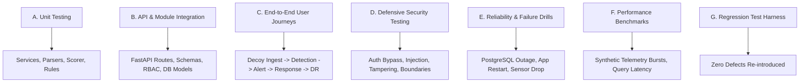

# SnareSight Comprehensive Test Strategy & QA Framework

## 1. Quality Philosophy & Scope

SnareSight is a browser-based Deception-Driven Threat Detection and Security Operations Platform. Testing is not an afterthought or an arbitrary coverage percentage game; it is the verifiable assurance that:
1. Honeypot telemetry cannot bypass sanitization or compromise the core database.
2. Behavioral detection rules trigger deterministically with explainable confidence and evidence references.
3. Attack session correlation cannot be spoofed by IP collisions.
4. Administrative workflows (approvals, playbooks, backups, restore tests) enforce strict RBAC and audit immutability.
5. The platform can recover safely from internal failures without corrupting or losing telemetry.

---

## 2. Test Classification Taxonomy



### A. Unit Testing
- **Focus**: Pure logic, normalization functions, mathematical scoring formulas, rule condition matchers, and token parsers.
- **Environment**: Isolated, fast, in-memory fixtures.
- **Execution Target**: $< 5\text{ seconds}$ total runtime.

### B. Integration Testing
- **Focus**: Contract compliance across FastAPI routers, SQLAlchemy ORM models, transaction boundaries, and Alembic migrations.
- **Environment**: Isolated SQLite / disposable PostgreSQL test container with dynamic schema setup and teardown.

### C. End-to-End Workflow Testing
- **Focus**: Complete analyst operational lifecycle through the browser:
  - Telemetry intake from synthetic decoys.
  - Alert triage and MITRE ATT&CK mapping review.
  - Case creation, recommendation decision, two-person human approval, and safe action execution.
  - Controlled database backup creation and isolated sandbox recovery.

### D. Defensive Security Testing
- **Focus**: Testing application boundaries, prevention of SQL injection, cross-site scripting (XSS), token replay, unauthorized privilege escalation, and honeypot isolation invariants (ensuring honeypot inputs never touch system command shells or PostgreSQL directly).

### E. Reliability & Resilience Testing
- **Focus**: Verifying graceful degradation, SSE stream auto-reconnection, telemetry buffering during database downtime, and automated restore verification tests in sandboxes.

### F. Performance & Scalability Testing
- **Focus**: Response latency under synthetic burst traffic, query execution plans on indexed columns (`timestamp`, `source_ip`, `sensor_id`), and pagination at scale.

### G. Regression Testing
- **Focus**: Automated verification that every resolved defect in `docs/testing/defect-register.md` includes a regression test that remains permanently green.

---

## 3. Test Environments & Isolation Policy

| Environment Tier | Target Subsystems | Backing Datastore | State Management |
| :--- | :--- | :--- | :--- |
| **Tier 1: Unit & Fast Integration** | Backend rules, scoring, schemas, routing | In-Memory SQLite (`sqlite:///:memory:`) with `StaticPool` | Fresh DB instantiated per test class via `setUpClass`/`tearDownClass` |
| **Tier 2: Component UI Testing** | React components, modals, filters, charts | `happy-dom` virtual browser environment | Isolated component mounting with mocked API clients |
| **Tier 3: E2E Workflows** | Complete FastAPI + React runtime | Disposable PostgreSQL test database | Clean seed data generated synthetically |
| **Tier 4: Restore Sandbox** | Backup verification engine | Isolated sandbox database (`isolated_sandbox_db`) | Completely segregated from production tables |

---

## 4. Test Data Policy & Privacy Guardrails

1. **Zero Real Passwords**: All test fixtures use synthetic mock passwords (e.g., `TestPass2026!`).
2. **Zero Attacker Secrets**: Honeypot inputs must never contain real production credentials or private keys.
3. **Synthetic IP Allocation**: IP addresses use reserved RFC 5737 / RFC 1918 test blocks (`10.0.0.0/8`, `192.0.2.0/24`, `198.51.100.0/24`).
4. **Deterministic Seed State**: Fixtures generate identical timestamps and cryptographic IDs for reproducible test runs.

---

## 5. Local Test Execution Commands

```powershell
# 1. Backend Core & Integration Suite
cd c:\Projects\SnareSight\backend
$env:PYTHONPATH="c:\Projects\SnareSight\backend"
python -m unittest discover -s tests -p "test_*.py"

# 2. Specific Subsystem Tests (e.g. Resilience)
python -m unittest discover -s tests/modules/resilience -p "test_*.py"

# 3. Model & Schema Integrity
python -m unittest tests/test_models.py

# 4. Frontend Type Checking
cd c:\Projects\SnareSight\frontend
npx tsc

# 5. Frontend Production Build
npm run build
```

---

## 6. Known Testing Limitations

1. **Simulated Honeynet in Local Dev**: In local development environments, honeypot sensors operate via synthetic telemetry adapters rather than live Linux virtual machine decoys.
2. **Reverse Proxy Buffering**: Certain HTTP proxy layers (e.g. Nginx without `proxy_buffering off`) can buffer Server-Sent Events (SSE). E2E tests bypass proxy intermediaries to test FastAPI SSE broker directly.

